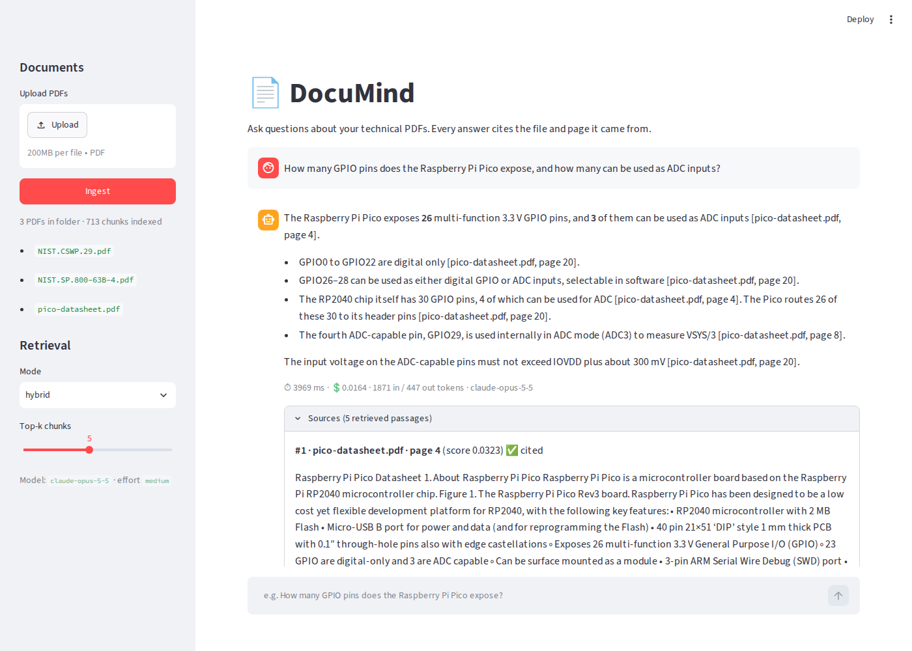
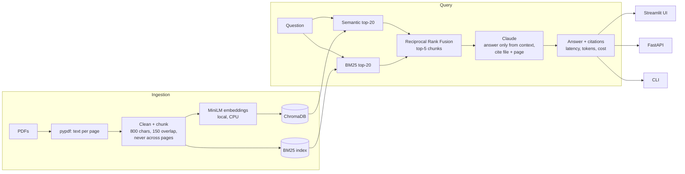

# DocuMind

[](https://github.com/Rayyan3079/documind-rag/actions/workflows/ci.yml)
[](LICENSE)

**Ask questions about technical PDF manuals and get answers that cite the exact file and
page, plus a built-in evaluation that measures how often those answers are right.**

DocuMind is a retrieval-augmented generation (RAG) system built from the components up:
PDF ingestion and chunking, local embeddings in ChromaDB, BM25 keyword search, hybrid
retrieval with Reciprocal Rank Fusion, and answers from Claude that must cite their
sources or say they could not find the answer. It runs as a CLI, a REST API and a
Streamlit web app, and ships with a 26-question test set and an evaluation harness.

On that test set, with hybrid retrieval and `claude-opus-5-5`, it answered **20 of 22
answerable questions correctly (91%)** and **refused all 4 unanswerable questions**,
at a median latency of 3.3 s and a total cost of $0.44 for the whole run including the
judge. [Full results](eval/results/summary.md).



## Architecture



All three interfaces go through the same `DocuMind` class, so they behave identically.
Re-ingestion is idempotent: files are hashed and only new or changed PDFs are re-embedded.
Design decisions are explained in [docs/DESIGN.md](docs/DESIGN.md).

## Tech stack

| Area | Tools |
|---|---|
| Language | Python 3.11 |
| LLM | Claude via the Anthropic Python SDK (`claude-opus-5-5` by default, configurable) |
| Embeddings | `sentence-transformers/all-MiniLM-L6-v2` (local, CPU-only PyTorch) |
| Vector store | ChromaDB (persistent, on disk) |
| Keyword search | `rank-bm25` (Okapi BM25) |
| PDF parsing | `pypdf` |
| Interfaces | Typer CLI, FastAPI + Uvicorn, Streamlit |
| Testing / CI | pytest (37 tests, fake embedder and mocked Claude client), GitHub Actions |
| Packaging | Docker, `pyproject.toml` |

## Quick start

Requires Python 3.11+ and an [Anthropic API key](https://console.anthropic.com/).

```bash
git clone https://github.com/Rayyan3079/documind-rag.git
cd documind-rag
python -m venv .venv && source .venv/bin/activate
pip install torch --index-url https://download.pytorch.org/whl/cpu   # CPU-only, much smaller
pip install -e ".[dev]"
```

Get the demo corpus. The two NIST PDFs are in the repo. The Raspberry Pi datasheet is
downloaded, not redistributed (see [data/docs/SOURCES.md](data/docs/SOURCES.md)).

```bash
curl -fL -o data/docs/pico-datasheet.pdf https://datasheets.raspberrypi.com/pico/pico-datasheet.pdf
```

Add your key and build the index:

```bash
cp .env.example .env        # then set ANTHROPIC_API_KEY in .env
python -m documind ingest
```

Ask from the command line:

```bash
python -m documind ask "What input voltage range is allowed on the Pico's VSYS pin?"
python -m documind ask "Which GPIO drives the Pico's user LED?" --mode bm25 --show-chunks
```

Or run the web app or the REST API:

```bash
streamlit run app.py                 # http://localhost:8501
uvicorn documind.api:app --reload    # http://localhost:8000/docs  (POST /ask, POST /ingest, GET /health)
```

Run the tests (no API key or model download needed):

```bash
pytest
```

## Docker

Download the datasheet first (see above) so it is copied into the image. The embedding
model is baked into the image, so the container starts without downloading it.

```bash
docker build -t documind .
docker run --rm -p 8501:8501 -e ANTHROPIC_API_KEY=your-key documind
```

Open http://localhost:8501 and click **Ingest** in the sidebar to build the index.

## Evaluation

`eval/questions.jsonl` has 26 hand-written questions across three PDFs: the Raspberry Pi
Pico datasheet, NIST Cybersecurity Framework 2.0 and NIST SP 800-63B-4. 22 have a reference
answer and evidence page(s), and 4 ask for something that is not in the documents.

```bash
python eval/run_eval.py                    # full run (needs an API key)
python eval/run_eval.py --retrieval-only   # retrieval metrics only, free
```

Results below are from a real run, copied from
[eval/results/summary.md](eval/results/summary.md). Every answer and judge verdict is in
[eval/results/answers.jsonl](eval/results/answers.jsonl). Corpus: 713 chunks from 3 PDFs.

**Retrieval** (22 answerable questions, k = 5; a hit means a retrieved chunk is from an evidence page):

| Mode | Hit rate@5 | Hit rate@1 | MRR |
|---|---|---|---|
| Semantic (MiniLM) | 91% | 64% | 0.748 |
| BM25 | 100% | 82% | 0.894 |
| **Hybrid (RRF)** | **100%** | **86%** | **0.898** |

**Answers** (`claude-opus-5-5`, effort `medium`, hybrid retrieval, k = 5; judged by `claude-opus-5-5`):

| Metric | Result |
|---|---|
| Correct | 20/22 (91%) |
| Correct or partially correct | 21/22 (95%) |
| Wrong | 1 (a false "not found") |
| Answer cites an evidence page | 95% |
| Correct refusals on unanswerable questions | 4/4 (100%) |
| Latency p50 / p95 | 3.3 s / 6.1 s |
| Avg tokens per answer (in / out) | 1651 / 321 |
| Cost for the full run: answers / judge / total | $0.339 / $0.104 / $0.443 |

How the metrics and the LLM judge work is explained in [docs/DESIGN.md](docs/DESIGN.md#4-evaluation).

### Observations

1. **Semantic search alone was the weakest retriever on technical text.** It missed the
   evidence page entirely on 2 of 22 questions and ranked it first only 64% of the time.
   BM25 did much better (MRR 0.894 vs 0.748) because questions about manuals are full of
   exact identifiers like `VSYS`, `GPIO23` or `AAL2`, which a small embedding model blurs.
2. **Hybrid beat BM25 only narrowly here.** MRR 0.898 vs 0.894, and hit rate@1 86% vs 82%,
   which is one question out of 22. On this test set most of the gain over semantic search
   comes from adding keyword search at all.
3. **Both mistakes came from chunk boundaries, not from the model.** For the two questions
   that were not fully correct, retrieval found the right *page*, but the sentence with the
   answer was in the neighbouring chunk on that page, which was not retrieved. For the 3V3
   load-current question, BM25 ranked the answer chunk first, but RRF dropped it in favour
   of chunks both retrievers liked. Claude then said "not found" rather than guessing, which
   is the intended behaviour, but it counts as a wrong answer.
4. **Page-level retrieval metrics are optimistic.** The two cases above count as retrieval
   hits because *a* chunk from the evidence page was retrieved. Hybrid's 100% hit rate does
   not mean the answer text always reached the model; chunk-level labels would measure that.
5. **The refusal and citation behaviour held up, but the sample is small.** All 4
   unanswerable questions were refused and 95% of answers cited an evidence page. With only
   4 negative questions, the 100% refusal rate is a good sign, not a guarantee.

## What I learned

- **Measure retrieval separately from generation.** Splitting the eval into retrieval
  metrics and judged answers made it possible to trace both failures to chunking, instead
  of guessing whether to change the prompt or the model.
- **Keyword search still matters.** On identifier-heavy technical documents, BM25 alone was far stronger than a small embedding model.
- **Rank fusion is simple and robust, but not free.** RRF needs no score calibration,
  but it can bury a result that only one retriever finds, as it did here.
- **Metrics need to match the unit you care about.** A page-level hit rate looked perfect
  while the model was still missing the answer text.
- **Design for "I don't know".** A fixed refusal sentence made refusals machine-checkable,
  so hallucination on unanswerable questions could be measured, not just hoped against.
- **Testing LLM code without an API key.** Injecting a fake embedder and a mocked Claude
  client keeps the 37 unit tests fast and free, so CI runs on every push.

## Next steps

- Return the neighbouring chunks of each hit (or use larger, overlapping parent chunks) so
  an answer split across a chunk boundary still reaches the model.
- Label evidence at chunk or sentence level and report chunk-level hit rate alongside page-level.
- Add a cross-encoder reranker after fusion and compare it with plain RRF.
- Grow the test set, especially unanswerable and multi-page questions, so differences
  between configurations are statistically meaningful.
- Compare answer models (Opus vs Sonnet vs Haiku) on accuracy, latency and cost per question.
- Handle tables and figures better (PDF layout parsing instead of plain text extraction).

## Project layout

```
documind/        core package: ingest, store, retrieve, answer, rag, cli, api
app.py           Streamlit UI
eval/            questions.jsonl, run_eval.py, results/
scripts/         download_docs.py, screenshot.py
tests/           pytest suite (no network or API key needed)
docs/            DESIGN.md, screenshot.png
```

## License

[MIT](LICENSE) © Rayyan Laeeq. The demo PDFs have their own licenses; see
[data/docs/SOURCES.md](data/docs/SOURCES.md).
